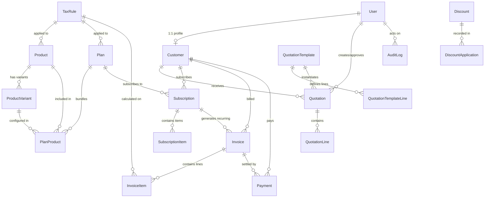

# 🗄️ Shared Database Design & Mongoose Schemas

> **Task 4 Deliverable**: Comprehensive MongoDB / Mongoose schema design for the Subscription Management System (SMS).
> Covers 19 models with strict TypeScript types, lifecycle status enums, unique constraints, compound indexes, high-precision monetary handling, and historical price/tax preservation.

---

## 1. Architectural Principles

### 1.1 Financial Precision & Zero Floating-Point Arithmetic
JavaScript's native IEEE 754 floating-point arithmetic introduces rounding artifacts (e.g., `0.1 + 0.2 === 0.30000000000000004`). In financial billing and invoicing, this causes unacceptable reconciliation errors across taxes, discounts, and payment settlements.

**The System Enforces:**
1. **Database Storage**: All monetary amounts, line totals, and tax rates are stored as MongoDB BSON `Decimal128` (`Schema.Types.Decimal128`), supporting 34 significant decimal digits of precision.
2. **Computational Engine**: All calculations are executed strictly using `Money` (powered by `Decimal.js` with 28 digits precision and `ROUND_HALF_UP` bankers/financial rounding). Native JavaScript arithmetic operators (`+`, `-`, `*`, `/`) are **strictly prohibited** on monetary fields.
3. **Integer Minor Units Integration**: For payment gateways requiring integer minor units (e.g., cents, paise in Stripe/Razorpay), `Money.toMinorUnits` and `Money.fromMinorUnits` provide exact, lossless conversions (e.g., `$19.99` $\rightarrow$ `1999n`).
4. **Serialization Safety**: Schema `toJSON` and `toObject` options automatically transform `Decimal128` fields into clean formatted strings (`"19.99"`), preventing precision loss when serializing over JSON HTTP endpoints.

### 1.2 Historical Price & Tax Preservation
In SaaS subscription billing, catalog prices, discounts, and tax rates change over time. When updates occur, active subscriptions and past legal invoices must remain uncorrupted:
- **Subscriptions (`SubscriptionItem`)**: Grandfathered pricing is locked into `unitPriceSnapshot`, `taxRateSnapshot`, and `discountAmountSnapshot` at subscription creation or plan upgrade time. Subsequent price changes to the product catalog never modify existing subscriptions.
- **Invoices (`Invoice`, `InvoiceItem`)**: Invoices are legally immutable financial records. Customer contact information and address are captured in `billingAddressSnapshot`. Each line item locks in `unitPriceSnapshot`, `taxRateSnapshot`, `taxAmountSnapshot`, `discountAmountSnapshot`, `lineSubtotal`, and `lineTotal`.
- **Quotations (`QuotationLine`)**: Captures frozen snapshots of prices and tax rates valid during the proposal window.
- **Discounts (`DiscountApplication`)**: Audits the exact discount formula snapshot and the calculated currency amount deducted at transaction time.

---

## 2. Entity Relationship Diagram

---

## 3. Lifecycle Status Enums Reference

| Model | Status Field | Allowed Enum Values | Default Value | Description |
|---|---|---|---|---|
| **User** | `role` | `'admin'`, `'staff'`, `'customer'` | `'customer'` | Role-based authorization guard |
| **User** | `status` | `'active'`, `'inactive'`, `'suspended'` | `'active'` | Account login & access lifecycle |
| **Customer** | `status` | `'active'`, `'inactive'`, `'suspended'`, `'archived'` | `'active'` | Customer CRM state |
| **Customer** | `paymentTerms` | `'due_on_receipt'`, `'net_15'`, `'net_30'`, `'net_60'` | `'due_on_receipt'` | Credit & invoice terms |
| **Product** | `status` | `'draft'`, `'active'`, `'archived'` | `'active'` | Catalog availability |
| **ProductVariant** | `status` | `'active'`, `'inactive'`, `'discontinued'` | `'active'` | Variant lifecycle state |
| **ProductVariant** | `billingCycle` | `'daily'`, `'weekly'`, `'monthly'`, `'quarterly'`, `'semi_annual'`, `'yearly'`, `'one_time'` | `'monthly'` | Recurrence schedule |
| **Plan** | `status` | `'draft'`, `'active'`, `'archived'` | `'active'` | Subscription tier availability |
| **PlanProduct** | `pricingType` | `'flat_fee'`, `'per_unit'`, `'tiered'`, `'volume'` | `'per_unit'` | Plan pricing calculation formula |
| **QuotationTemplate** | `status` | `'draft'`, `'active'`, `'archived'` | `'active'` | Reusable template state |
| **Quotation** | `status` | `'draft'`, `'sent'`, `'accepted'`, `'rejected'`, `'expired'`, `'converted'` | `'draft'` | Sales quotation lifecycle |
| **Subscription** | `status` | `'trialing'`, `'active'`, `'paused'`, `'past_due'`, `'cancelled'`, `'expired'` | `'active'` | Subscription billing lifecycle |
| **SubscriptionItem** | `status` | `'active'`, `'paused'`, `'cancelled'` | `'active'` | Line-item subscription state |
| **Invoice** | `status` | `'draft'`, `'issued'`, `'paid'`, `'partially_paid'`, `'overdue'`, `'void'`, `'refunded'` | `'draft'` | Billing ledger lifecycle |
| **Payment** | `status` | `'pending'`, `'processing'`, `'completed'`, `'failed'`, `'refunded'`, `'partially_refunded'` | `'pending'` | Settlement transaction state |
| **Payment** | `method` | `'card'`, `'bank_transfer'`, `'upi'`, `'cash'`, `'wallet'`, `'other'` | N/A | Payment instrument |
| **Discount** | `type` | `'percentage'`, `'fixed_amount'` | N/A | Discount calculation mechanism |
| **Discount** | `status` | `'draft'`, `'active'`, `'expired'`, `'disabled'` | `'active'` | Coupon validity lifecycle |
| **DiscountApplication** | `appliedToEntity` | `'quotation'`, `'subscription'`, `'invoice'` | N/A | Target document category |
| **TaxRule** | `taxType` | `'sales_tax'`, `'vat'`, `'gst'`, `'custom'` | N/A | Jurisdiction tax categorization |
| **TaxRule** | `status` | `'active'`, `'inactive'`, `'deprecated'` | `'active'` | Tax governance state |

---

## 4. Models & Detailed Specifications

### 4.1 User (`users`)
Manages authentication credentials, access roles, and audit identity.
- **Fields**:
  - `name`: `String` (required, trim, 2-100 chars)
  - `email`: `String` (required, unique, lowercase, trim, regex validated)
  - `passwordHash`: `String` (required, minlength: 60)
  - `role`: `Enum ['admin', 'staff', 'customer']` (default: `'customer'`, index)
  - `status`: `Enum ['active', 'inactive', 'suspended']` (default: `'active'`, index)
  - `phone`: `String` (trim)
  - `avatar`: `String` (URL)
  - `refreshToken`: `String` (hidden from queries via `select: false`)
  - `isEmailVerified`: `Boolean` (default: false)
  - `lastLoginAt`: `Date`
  - `createdAt`, `updatedAt`: `Date`
- **Indexes**:
  - `{ email: 1 }` (unique)
  - `{ role: 1, status: 1 }`
  - `{ createdAt: -1 }`

---

### 4.2 Customer (`customers`)
Represents customer CRM and billing profile linked 1:1 to a `User`.
- **Fields**:
  - `user`: `ObjectId -> User` (required, unique 1:1 reference)
  - `customerNumber`: `String` (required, unique, uppercase, format: `CUST-XXXX`)
  - `companyName`: `String` (trim, max: 200 chars)
  - `billingAddress`: Embedded Document (`street`, `city`, `state`, `country`, `postalCode` all required)
  - `shippingAddress`: Embedded Document (optional)
  - `taxId`: `String` (VAT / GSTIN / TIN, uppercase)
  - `currency`: `String` (required, default: `'USD'`, 3-letter ISO code)
  - `status`: `Enum ['active', 'inactive', 'suspended', 'archived']` (default: `'active'`, index)
  - `defaultPaymentMethod`: `Enum ['card', 'bank_transfer', 'upi', 'cash', 'wallet', 'other']`
  - `paymentTerms`: `Enum ['due_on_receipt', 'net_15', 'net_30', 'net_60']` (default: `'due_on_receipt'`)
  - `metadata`: `Mixed` (default: `{}`)
  - `createdAt`, `updatedAt`: `Date`
- **Indexes**:
  - `{ user: 1 }` (unique)
  - `{ customerNumber: 1 }` (unique)
  - `{ status: 1, createdAt: -1 }`
  - `{ 'billingAddress.country': 1 }`
  - `{ companyName: 1 }`

---

### 4.3 Product (`products`)
Catalog of products or subscription offerings.
- **Fields**:
  - `name`: `String` (required, trim, 2-200 chars)
  - `slug`: `String` (required, unique, lowercase, URL-friendly)
  - `code`: `String` (required, unique, uppercase, SKU prefix)
  - `description`: `String` (max 2000 chars)
  - `category`: `String` (required, index)
  - `status`: `Enum ['draft', 'active', 'archived']` (default: `'active'`, index)
  - `isRecurring`: `Boolean` (default: true)
  - `taxRule`: `ObjectId -> TaxRule` (default tax rule)
  - `createdBy`: `ObjectId -> User`
  - `metadata`: `Mixed`
  - `createdAt`, `updatedAt`: `Date`
- **Indexes**:
  - `{ slug: 1 }` (unique)
  - `{ code: 1 }` (unique)
  - `{ category: 1, status: 1 }`
  - `{ name: 'text', description: 'text' }` (full-text search)
  - `{ status: 1, createdAt: -1 }`

---

### 4.4 ProductVariant (`productvariants`)
Specific sku, tier, or attribute variation of a product.
- **Fields**:
  - `product`: `ObjectId -> Product` (required, index)
  - `name`: `String` (required, trim)
  - `sku`: `String` (required, unique, uppercase)
  - `price`: `Decimal128` (required, min: 0)
  - `currency`: `String` (default: `'USD'`, 3-letter ISO code)
  - `billingCycle`: `Enum ['daily', 'weekly', 'monthly', 'quarterly', 'semi_annual', 'yearly', 'one_time']` (default: `'monthly'`)
  - `attributes`: `[{ name: String, value: String }]`
  - `features`: `[String]`
  - `status`: `Enum ['active', 'inactive', 'discontinued']` (default: `'active'`, index)
  - `isDefault`: `Boolean` (default: false)
  - `createdAt`, `updatedAt`: `Date`
- **Indexes**:
  - `{ sku: 1 }` (unique)
  - `{ product: 1, status: 1 }`
  - `{ product: 1, isDefault: 1 }`

---

### 4.5 Plan (`plans`)
Recurring subscription plan definitions.
- **Fields**:
  - `name`: `String` (required, trim)
  - `code`: `String` (required, unique, uppercase, e.g. `PLAN-PRO-ANNUAL`)
  - `description`: `String` (max 1000 chars)
  - `basePrice`: `Decimal128` (required, min: 0)
  - `currency`: `String` (default: `'USD'`, 3-letter ISO code)
  - `billingCycle`: `Enum ['daily', 'weekly', 'monthly', 'quarterly', 'semi_annual', 'yearly', 'one_time']` (required)
  - `billingInterval`: `Number` (required, min: 1, default: 1)
  - `trialPeriodDays`: `Number` (min: 0, default: 0)
  - `setupFee`: `Decimal128` (default: 0.00, min: 0)
  - `status`: `Enum ['draft', 'active', 'archived']` (default: `'active'`, index)
  - `isPublic`: `Boolean` (default: true, index)
  - `taxRule`: `ObjectId -> TaxRule`
  - `metadata`: `Mixed`
  - `createdAt`, `updatedAt`: `Date`
- **Indexes**:
  - `{ code: 1 }` (unique)
  - `{ status: 1, isPublic: 1 }`
  - `{ billingCycle: 1, status: 1 }`

---

### 4.6 PlanProduct (`planproducts`)
Junction model bundling products/variants into plans.
- **Fields**:
  - `plan`: `ObjectId -> Plan` (required, index)
  - `product`: `ObjectId -> Product` (required, index)
  - `variant`: `ObjectId -> ProductVariant` (optional)
  - `quantity`: `Number` (required, min: 1, default: 1)
  - `unitPriceOverride`: `Decimal128` (optional, min: 0)
  - `isOptional`: `Boolean` (default: false)
  - `pricingType`: `Enum ['flat_fee', 'per_unit', 'tiered', 'volume']` (default: `'per_unit'`)
  - `sortOrder`: `Number` (default: 0)
  - `createdAt`, `updatedAt`: `Date`
- **Indexes**:
  - `{ plan: 1, product: 1, variant: 1 }` (compound unique)
  - `{ plan: 1, sortOrder: 1 }`

---

### 4.7 QuotationTemplate (`quotationtemplates`)
Standard sales templates for generating quotes quickly.
- **Fields**:
  - `name`: `String` (required, unique, trim)
  - `code`: `String` (required, unique, uppercase)
  - `description`: `String`
  - `validityDays`: `Number` (required, min: 1, max: 365, default: 30)
  - `paymentTerms`: `Enum ['due_on_receipt', 'net_15', 'net_30', 'net_60']` (default: `'net_30'`)
  - `termsAndConditions`: `String` (max 5000 chars)
  - `status`: `Enum ['draft', 'active', 'archived']` (default: `'active'`, index)
  - `defaultDiscount`: `ObjectId -> Discount`
  - `defaultTaxRule`: `ObjectId -> TaxRule`
  - `createdBy`: `ObjectId -> User` (required)
  - `createdAt`, `updatedAt`: `Date`
- **Indexes**:
  - `{ name: 1 }` (unique)
  - `{ code: 1 }` (unique)
  - `{ status: 1, createdAt: -1 }`

---

### 4.8 QuotationTemplateLine (`quotationtemplatelines`)
Items pre-configured within a quotation template.
- **Fields**:
  - `template`: `ObjectId -> QuotationTemplate` (required, index)
  - `product`: `ObjectId -> Product` (required)
  - `variant`: `ObjectId -> ProductVariant` (optional)
  - `plan`: `ObjectId -> Plan` (optional)
  - `description`: `String` (required, trim)
  - `quantity`: `Number` (required, min: 1, default: 1)
  - `unitPrice`: `Decimal128` (required, min: 0)
  - `discountPercentage`: `Decimal128` (default: 0.00, min: 0, max: 100)
  - `taxRule`: `ObjectId -> TaxRule` (optional)
  - `sortOrder`: `Number` (default: 0)
  - `createdAt`, `updatedAt`: `Date`
- **Indexes**:
  - `{ template: 1, sortOrder: 1 }`

---

### 4.9 Quotation (`quotations`)
Sales quotation or formal customer proposal.
- **Fields**:
  - `quotationNumber`: `String` (required, unique, uppercase, format: `QT-XXXX`, index)
  - `customer`: `ObjectId -> Customer` (required, index)
  - `template`: `ObjectId -> QuotationTemplate` (optional)
  - `status`: `Enum ['draft', 'sent', 'accepted', 'rejected', 'expired', 'converted']` (default: `'draft'`, index)
  - `issueDate`: `Date` (required, default: Date.now)
  - `validUntil`: `Date` (required, validated `validUntil >= issueDate`)
  - `acceptedAt`: `Date`
  - `rejectedAt`: `Date`
  - `rejectionReason`: `String`
  - `convertedSubscription`: `ObjectId -> Subscription` (if converted)
  - `currency`: `String` (required, default: `'USD'`, 3-letter ISO code)
  - `subtotal`: `Decimal128` (required, default: 0.00, min: 0)
  - `discountTotal`: `Decimal128` (required, default: 0.00, min: 0)
  - `taxTotal`: `Decimal128` (required, default: 0.00, min: 0)
  - `totalAmount`: `Decimal128` (required, default: 0.00, min: 0)
  - `termsAndConditions`: `String`
  - `notes`: `String`
  - `createdBy`: `ObjectId -> User` (required, index)
  - `approvedBy`: `ObjectId -> User`
  - `createdAt`, `updatedAt`: `Date`
- **Indexes**:
  - `{ quotationNumber: 1 }` (unique)
  - `{ customer: 1, status: 1 }`
  - `{ status: 1, validUntil: 1 }`
  - `{ createdAt: -1 }`

---

### 4.10 QuotationLine (`quotationlines`)
Line item within a quotation preserving historical pricing and taxes.
- **Fields**:
  - `quotation`: `ObjectId -> Quotation` (required, index)
  - `product`: `ObjectId -> Product` (required)
  - `variant`: `ObjectId -> ProductVariant` (optional)
  - `plan`: `ObjectId -> Plan` (optional)
  - `description`: `String` (required, trim)
  - `quantity`: `Number` (required, min: 1, default: 1)
  - `unitPrice`: `Decimal128` (required, historical snapshot, min: 0)
  - `discountAmount`: `Decimal128` (default: 0.00, min: 0)
  - `discount`: `ObjectId -> Discount`
  - `taxRule`: `ObjectId -> TaxRule`
  - `taxRateSnapshot`: `Decimal128` (default: 0.00, min: 0, max: 100)
  - `taxAmount`: `Decimal128` (default: 0.00, min: 0)
  - `lineTotal`: `Decimal128` (required, min: 0)
  - `billingCycleSnapshot`: `Enum ['daily', 'weekly', 'monthly', 'quarterly', 'semi_annual', 'yearly', 'one_time']`
  - `sortOrder`: `Number` (default: 0)
  - `createdAt`, `updatedAt`: `Date`
- **Indexes**:
  - `{ quotation: 1, sortOrder: 1 }`

---

### 4.11 Subscription (`subscriptions`)
The core subscription entity governing access, billing cycles, renewals, and states.
- **Fields**:
  - `subscriptionNumber`: `String` (required, unique, uppercase, format: `SUB-XXXX`, index)
  - `customer`: `ObjectId -> Customer` (required, index)
  - `plan`: `ObjectId -> Plan` (required, index)
  - `quotation`: `ObjectId -> Quotation` (optional)
  - `status`: `Enum ['trialing', 'active', 'paused', 'past_due', 'cancelled', 'expired']` (default: `'active'`, index)
  - `billingCycle`: `Enum ['daily', 'weekly', 'monthly', 'quarterly', 'semi_annual', 'yearly', 'one_time']` (required)
  - `billingInterval`: `Number` (required, min: 1, default: 1)
  - `currency`: `String` (required, default: `'USD'`, 3-letter ISO code)
  - `startDate`: `Date` (required, default: Date.now)
  - `currentPeriodStart`: `Date` (required)
  - `currentPeriodEnd`: `Date` (required, validated `currentPeriodEnd >= currentPeriodStart`)
  - `trialStart`: `Date`
  - `trialEnd`: `Date` (validated `trialEnd >= trialStart`)
  - `nextBillingDate`: `Date` (indexed for cron billing jobs)
  - `autoRenew`: `Boolean` (default: true)
  - `pausedAt`: `Date`
  - `pauseReason`: `String`
  - `cancelledAt`: `Date`
  - `cancellationReason`: `String`
  - `cancellationEffectiveDate`: `Date`
  - `endedAt`: `Date`
  - `discount`: `ObjectId -> Discount`
  - `discountSnapshot`: Embedded `{ code: String, type: Enum, value: Decimal128 }`
  - `defaultPaymentMethod`: `Enum ['card', 'bank_transfer', 'upi', 'cash', 'wallet', 'other']`
  - `metadata`: `Mixed` (default: `{}`)
  - `createdBy`: `ObjectId -> User`
  - `createdAt`, `updatedAt`: `Date`
- **Indexes**:
  - `{ subscriptionNumber: 1 }` (unique)
  - `{ customer: 1, status: 1 }`
  - `{ status: 1, nextBillingDate: 1 }` (high-throughput recurring cron index)
  - `{ status: 1, currentPeriodEnd: 1 }`
  - `{ createdAt: -1 }`

---

### 4.12 SubscriptionItem (`subscriptionitems`)
Line item / add-on attached to a subscription, locking in historical grandfathered pricing.
- **Fields**:
  - `subscription`: `ObjectId -> Subscription` (required, index)
  - `product`: `ObjectId -> Product` (required)
  - `variant`: `ObjectId -> ProductVariant` (optional)
  - `planProduct`: `ObjectId -> PlanProduct` (optional)
  - `description`: `String` (required, trim)
  - `quantity`: `Number` (required, min: 1, default: 1)
  - `unitPriceSnapshot`: `Decimal128` (required, grandfathered locked unit price, min: 0)
  - `taxRule`: `ObjectId -> TaxRule`
  - `taxRateSnapshot`: `Decimal128` (default: 0.00, grandfathered locked tax rate %, min: 0, max: 100)
  - `discountAmountSnapshot`: `Decimal128` (default: 0.00, min: 0)
  - `status`: `Enum ['active', 'paused', 'cancelled']` (default: `'active'`, index)
  - `periodStartDate`: `Date`
  - `periodEndDate`: `Date` (validated `periodEndDate >= periodStartDate`)
  - `createdAt`, `updatedAt`: `Date`
- **Indexes**:
  - `{ subscription: 1, status: 1 }`
  - `{ subscription: 1, product: 1 }`

---

### 4.13 Invoice (`invoices`)
The legally immutable financial billing document.
- **Fields**:
  - `invoiceNumber`: `String` (required, unique, uppercase, format: `INV-XXXX`, index)
  - `customer`: `ObjectId -> Customer` (required, index)
  - `subscription`: `ObjectId -> Subscription` (optional, index)
  - `quotation`: `ObjectId -> Quotation` (optional)
  - `status`: `Enum ['draft', 'issued', 'paid', 'partially_paid', 'overdue', 'void', 'refunded']` (default: `'draft'`, index)
  - `issueDate`: `Date` (required, default: Date.now, index)
  - `dueDate`: `Date` (required, validated `dueDate >= issueDate`, index)
  - `paidAt`: `Date`
  - `voidedAt`: `Date`
  - `billingPeriodStart`: `Date`
  - `billingPeriodEnd`: `Date` (validated `billingPeriodEnd >= billingPeriodStart`)
  - `currency`: `String` (required, default: `'USD'`, 3-letter ISO code)
  - `subtotal`: `Decimal128` (required, default: 0.00, min: 0)
  - `discountTotal`: `Decimal128` (required, default: 0.00, min: 0)
  - `taxTotal`: `Decimal128` (required, default: 0.00, min: 0)
  - `totalAmount`: `Decimal128` (required, default: 0.00, min: 0)
  - `amountPaid`: `Decimal128` (required, default: 0.00, min: 0)
  - `amountDue`: `Decimal128` (required, default: 0.00, min: 0)
  - `isRecurring`: `Boolean` (default: false)
  - `billingAddressSnapshot`: Embedded Document (`name`, `email`, `companyName`, `street`, `city`, `state`, `country`, `postalCode`, `taxId` - immutable legal snapshot)
  - `paymentTerms`: `Enum ['due_on_receipt', 'net_15', 'net_30', 'net_60']` (default: `'due_on_receipt'`)
  - `notes`: `String`
  - `generatedBy`: `Enum ['system_cron', 'manual', 'quotation_conversion']` (default: `'system_cron'`)
  - `createdBy`: `ObjectId -> User`
  - `createdAt`, `updatedAt`: `Date`
- **Indexes**:
  - `{ invoiceNumber: 1 }` (unique)
  - `{ customer: 1, status: 1 }`
  - `{ subscription: 1, status: 1 }`
  - `{ status: 1, dueDate: 1 }` (overdue collection sweeps)
  - `{ createdAt: -1 }`

---

### 4.14 InvoiceItem (`invoiceitems`)
Line item of an invoice with immutable historical prices and tax calculations.
- **Fields**:
  - `invoice`: `ObjectId -> Invoice` (required, index)
  - `subscriptionItem`: `ObjectId -> SubscriptionItem` (optional)
  - `product`: `ObjectId -> Product` (optional)
  - `variant`: `ObjectId -> ProductVariant` (optional)
  - `description`: `String` (required, trim)
  - `quantity`: `Number` (required, min: 1, default: 1)
  - `unitPriceSnapshot`: `Decimal128` (required, historical unit price, min: 0)
  - `discountAmountSnapshot`: `Decimal128` (default: 0.00, historical discount, min: 0)
  - `taxRule`: `ObjectId -> TaxRule`
  - `taxRateSnapshot`: `Decimal128` (default: 0.00, historical tax %, min: 0, max: 100)
  - `taxAmountSnapshot`: `Decimal128` (default: 0.00, historical tax amount, min: 0)
  - `lineSubtotal`: `Decimal128` (required, min: 0)
  - `lineTotal`: `Decimal128` (required, min: 0)
  - `periodStartDate`: `Date`
  - `periodEndDate`: `Date`
  - `sortOrder`: `Number` (default: 0)
  - `createdAt`, `updatedAt`: `Date`
- **Indexes**:
  - `{ invoice: 1, sortOrder: 1 }`

---

### 4.15 Payment (`payments`)
Tracks payment transactions, refunds, and gateway settlement logs.
- **Fields**:
  - `paymentNumber`: `String` (required, unique, uppercase, format: `PAY-XXXX`, index)
  - `invoice`: `ObjectId -> Invoice` (required, index)
  - `customer`: `ObjectId -> Customer` (required, index)
  - `amount`: `Decimal128` (required, min: 0.01)
  - `currency`: `String` (required, default: `'USD'`, 3-letter ISO code)
  - `status`: `Enum ['pending', 'processing', 'completed', 'failed', 'refunded', 'partially_refunded']` (default: `'pending'`, index)
  - `method`: `Enum ['card', 'bank_transfer', 'upi', 'cash', 'wallet', 'other']` (required)
  - `transactionId`: `String` (sparse index for external gateway payment IDs)
  - `gatewayProvider`: `String` (e.g. `'stripe'`, `'razorpay'`, `'manual'`)
  - `gatewayResponse`: `Mixed` (raw webhook payload)
  - `paidAt`: `Date`
  - `failedAt`: `Date`
  - `failureReason`: `String`
  - `refundedAmount`: `Decimal128` (default: 0.00, min: 0)
  - `refundTransactionId`: `String`
  - `refundedAt`: `Date`
  - `recordedBy`: `ObjectId -> User`
  - `createdAt`, `updatedAt`: `Date`
- **Indexes**:
  - `{ paymentNumber: 1 }` (unique)
  - `{ invoice: 1, status: 1 }`
  - `{ customer: 1, status: 1 }`
  - `{ transactionId: 1 }` (sparse)
  - `{ createdAt: -1 }`

---

### 4.16 Discount (`discounts`)
Promotional codes, volume discounts, or referral coupons.
- **Fields**:
  - `code`: `String` (required, unique, uppercase, trim, index)
  - `name`: `String` (required, trim)
  - `description`: `String`
  - `type`: `Enum ['percentage', 'fixed_amount']` (required)
  - `value`: `Decimal128` (required, min: 0, validated `<= 100` if type is percentage)
  - `currency`: `String` (required if `type === 'fixed_amount'`)
  - `maxUses`: `Number` (optional, min: 1)
  - `usedCount`: `Number` (default: 0, min: 0)
  - `minOrderAmount`: `Decimal128` (default: 0.00, min: 0)
  - `validFrom`: `Date` (required, default: Date.now)
  - `validUntil`: `Date` (validated `validUntil >= validFrom`)
  - `applicablePlans`: `[ObjectId -> Plan]`
  - `applicableProducts`: `[ObjectId -> Product]`
  - `status`: `Enum ['draft', 'active', 'expired', 'disabled']` (default: `'active'`, index)
  - `createdAt`, `updatedAt`: `Date`
- **Indexes**:
  - `{ code: 1 }` (unique)
  - `{ status: 1, validFrom: 1, validUntil: 1 }`

---

### 4.17 DiscountApplication (`discountapplications`)
Immutable audit record of discounts applied to quotations, subscriptions, or invoices.
- **Fields**:
  - `discount`: `ObjectId -> Discount` (required, index)
  - `customer`: `ObjectId -> Customer` (required, index)
  - `appliedToEntity`: `Enum ['quotation', 'subscription', 'invoice']` (required, index)
  - `appliedToId`: `ObjectId` (required, index)
  - `discountTypeSnapshot`: `Enum ['percentage', 'fixed_amount']` (required)
  - `discountValueSnapshot`: `Decimal128` (required snapshot)
  - `calculatedAmount`: `Decimal128` (required, exact minor-unit or Decimal128 amount deducted snapshot, min: 0)
  - `appliedAt`: `Date` (required, default: Date.now)
  - `appliedBy`: `ObjectId -> User`
  - `createdAt`, `updatedAt`: `Date`
- **Indexes**:
  - `{ appliedToEntity: 1, appliedToId: 1 }`
  - `{ discount: 1, customer: 1 }`

---

### 4.18 TaxRule (`taxrules`)
Jurisdictional taxation rules.
- **Fields**:
  - `name`: `String` (required, trim, e.g. `'US California State Tax'`, `'India GST 18%'`)
  - `code`: `String` (required, unique, uppercase, trim, index)
  - `taxType`: `Enum ['sales_tax', 'vat', 'gst', 'custom']` (required)
  - `rate`: `Decimal128` (required, min: 0, max: 100, e.g. 18.00)
  - `country`: `String` (required, uppercase, 2-letter ISO 3166-1 alpha-2, index)
  - `state`: `String` (uppercase, optional)
  - `postalCode`: `String` (optional)
  - `isCompound`: `Boolean` (default: false)
  - `isInclusive`: `Boolean` (default: false)
  - `status`: `Enum ['active', 'inactive', 'deprecated']` (default: `'active'`, index)
  - `effectiveFrom`: `Date` (required, default: Date.now)
  - `effectiveUntil`: `Date` (validated `effectiveUntil >= effectiveFrom`)
  - `createdAt`, `updatedAt`: `Date`
- **Indexes**:
  - `{ code: 1 }` (unique)
  - `{ country: 1, state: 1, status: 1 }`
  - `{ status: 1, effectiveFrom: 1, effectiveUntil: 1 }`

---

### 4.19 AuditLog (`auditlogs`)
Append-only, immutable audit trail for security, compliance, and dispute resolution.
- **Fields**:
  - `actor`: `ObjectId -> User` (optional, null for automated system crons, index)
  - `actorRole`: `String`
  - `action`: `String` (required, trim, index, e.g. `'subscription.created'`, `'invoice.paid'`)
  - `entity`: `String` (required, trim, index, e.g. `'Subscription'`, `'Invoice'`)
  - `entityId`: `ObjectId` (required, index)
  - `previousState`: `Mixed` (prior snapshot)
  - `newState`: `Mixed` (updated snapshot)
  - `changes`: `Mixed` (field-level delta)
  - `ipAddress`: `String` (max 45 chars for IPv4/IPv6)
  - `userAgent`: `String` (max 500 chars)
  - `createdAt`: `Date` (required, default: Date.now, indexed)
- **Immutability Policy**: `timestamps: { createdAt: true, updatedAt: false }`. Audit logs are strictly write-once.
- **Indexes**:
  - `{ entity: 1, entityId: 1, createdAt: -1 }`
  - `{ actor: 1, createdAt: -1 }`
  - `{ action: 1, createdAt: -1 }`
  - `{ createdAt: -1 }`

---

## 5. Unique Constraints Matrix

| Collection | Field(s) | Constraint Type |
|---|---|---|
| `users` | `email` | Unique (single field) |
| `customers` | `user` | Unique (1:1 relation with User) |
| `customers` | `customerNumber` | Unique (single field) |
| `products` | `slug` | Unique (single field) |
| `products` | `code` | Unique (single field) |
| `productvariants` | `sku` | Unique (single field) |
| `plans` | `code` | Unique (single field) |
| `planproducts` | `{ plan, product, variant }` | Compound Unique |
| `quotationtemplates` | `name` | Unique (single field) |
| `quotationtemplates` | `code` | Unique (single field) |
| `quotations` | `quotationNumber` | Unique (single field) |
| `subscriptions` | `subscriptionNumber` | Unique (single field) |
| `invoices` | `invoiceNumber` | Unique (single field) |
| `payments` | `paymentNumber` | Unique (single field) |
| `discounts` | `code` | Unique (single field) |
| `taxrules` | `code` | Unique (single field) |
